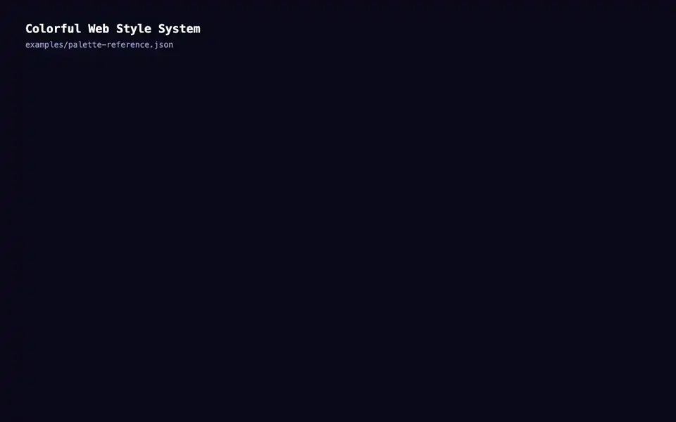
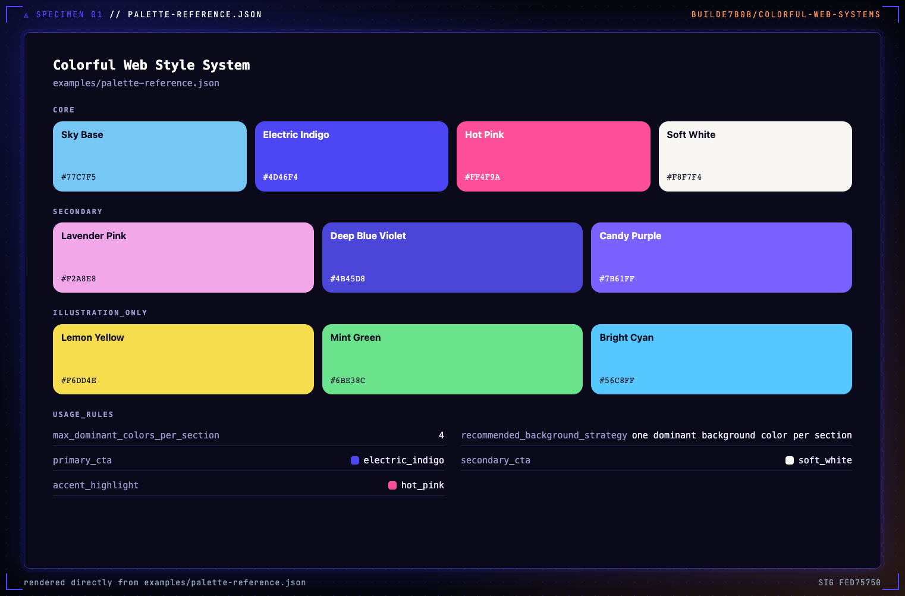
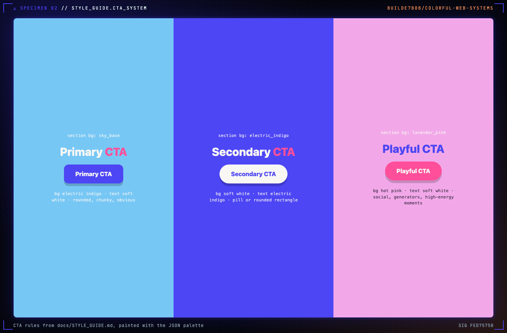

<p align="center">
  
</p>

<p align="center">
  
  
  
  
</p>

# Colorful Web Style System

A practical reference repo for designing and rebuilding **bold, colorful, high-energy websites** inspired by mascot-driven, internet-native brands.

This repo turns the color analysis into a **repeatable design system** you can use as a source of truth for future sites, landing pages, microsites, campaigns, and AI-assisted redesigns. It is documentation, prompts and a palette file. There is nothing to install or build.

<p align="center">
  
  <br>
  <sub>◬ transmission decoded from <code>examples/palette-reference.json</code> and <code>docs/STYLE_GUIDE.md</code>: every hex value and rule shown is read from those files, rendered in headless Chromium</sub>
</p>

<p align="center">
  <a href="#-borrow-the-principles-not-the-site">Purpose</a> ·
  <a href="#-why-sites-look-dead-and-the-fix">Philosophy</a> ·
  <a href="#-five-quick-start-rules">Rules</a> ·
  <a href="#-from-screenshot-to-site-system">Workflow</a> ·
  <a href="#-whats-in-the-archive">Contents</a> ·
  <a href="#-where-this-system-fits">Fit</a> ·
  <a href="#-reference-screenshots">References</a>
</p>

It is built for teams using:
Cursor · ChatGPT · Claude · v0 · Lovable · Replit · Figma AI tools · image generation tools for concept art and branded scenes.

<p align="center"></p>

##  Borrow the principles, not the site

Use this repo when you want to:
- make a site feel more alive
- add more color without making it chaotic
- create playful but structured web brands
- guide AI tools with a stable visual system
- keep design direction consistent across projects
- store screenshots and references in one place

> [!IMPORTANT]
> This is **not** a copy-the-site repo. It is a **system extraction repo**.

The goal is to borrow the principles:
- bold section-based color shifts
- high-contrast CTA structure
- strong palette discipline
- character/UI color cohesion
- playful, memorable emotional design

##  Why sites look dead, and the fix

Most dead-looking websites have the same problem:
- too much gray
- weak CTA contrast
- one repetitive background tone
- no emotional color hierarchy
- colors that are technically safe but visually forgettable

The fix is **not** "add random colors everywhere."

The fix is:
1. one dominant background color per section
2. one clear accent color for energy
3. one structural color for hierarchy and CTA logic
4. strong contrast between sections
5. art, UI, and typography all living in the same visual universe

##  Five quick-start rules

| # | Rule | Detail |
|---|---|---|
| 1 | **Use a tight palette** | Base your site around sky blue, electric indigo, hot pink, soft white, and one or two rotating scene colors like lavender or deep blue-violet. |
| 2 | **Design section by section** | Each section should feel like a **scene**, not just another box on the page. |
| 3 | **Keep backgrounds simple** | Use large flat fills or very soft gradients. Avoid muddy complexity. |
| 4 | **Make CTAs obvious** | Primary buttons should be impossible to miss. |
| 5 | **Use color with hierarchy** | Not every element deserves attention. Let a few things win. |

<table>
  <tr>
    <td width="50%"></td>
    <td width="50%"></td>
  </tr>
  <tr>
    <td><sub><b>Specimen 01 · the palette.</b> Every swatch and usage rule in <code>examples/palette-reference.json</code>. Illustration-only accents stay out of UI chrome.</sub></td>
    <td><sub><b>Specimen 02 · the CTA system.</b> Primary, secondary and playful CTAs as specified in <code>docs/STYLE_GUIDE.md</code>. An illustrative render of the rules, not a shipped page.</sub></td>
  </tr>
</table>

<p align="center"></p>

##  From screenshot to site system

1. **Save screenshots.** Drop reference screenshots into `reference-screenshots/`.
2. **Review them using the template.** Use [`docs/SCREENSHOT_REVIEW_TEMPLATE.md`](docs/SCREENSHOT_REVIEW_TEMPLATE.md) to analyze background system, CTA hierarchy, mood shifts, palette rhythm and visual cohesion.
3. **Pick a palette direction.** Start from [`examples/palette-reference.json`](examples/palette-reference.json) and adapt it to your brand.
4. **Guide your AI.** Use the prompts in [`prompts/`](prompts/) and the system language in [`docs/AI_PROMPT_LIBRARY.md`](docs/AI_PROMPT_LIBRARY.md).
5. **Build and refine.** Use [`docs/BUILD_WORKFLOW.md`](docs/BUILD_WORKFLOW.md) to turn references into an actual site system.

### Using it as the source of truth

When working with AI, point back to this repo and say:

> Follow the color system, section design logic, CTA hierarchy, and playful brand rules in this repo. Use the style guide as the source of truth.

That prevents drift and stops your site from turning into generic gradient soup.

##  What's in the archive

| Path | What it holds |
|---|---|
| [`docs/STYLE_GUIDE.md`](docs/STYLE_GUIDE.md) | Brand feeling, palette structure with hex values, palette rules, section formula, CTA system, typography, background and component rules, anti-patterns |
| [`docs/DESIGN_PRINCIPLES.md`](docs/DESIGN_PRINCIPLES.md) | Ten principles, from "Color is structure" to "Use intensity with purpose" |
| [`docs/BUILD_WORKFLOW.md`](docs/BUILD_WORKFLOW.md) | Eight steps: collect references, analyze, brand translation, color map, component library, test for dead zones, refine with AI, document |
| [`docs/AI_PROMPT_LIBRARY.md`](docs/AI_PROMPT_LIBRARY.md) | Six prompts: master redesign, CTA upgrade, section mood, color discipline, brand-world cohesion, premium-playful |
| [`docs/SCREENSHOT_REVIEW_TEMPLATE.md`](docs/SCREENSHOT_REVIEW_TEMPLATE.md) | Fill-in template per screenshot: dominant background, text, accent, CTA, supporting colors, and what to borrow |
| [`prompts/`](prompts/) | Paste-ready prompts: `redesign-prompt.txt`, `landing-page-prompt.txt`, `section-color-prompt.txt`, `mascot-brand-prompt.txt` |
| [`examples/palette-reference.json`](examples/palette-reference.json) | The palette as data: `core`, `secondary`, `illustration_only` and `usage_rules` |
| [`reference-screenshots/`](reference-screenshots/) | Five reference captures, `Screenshot-1.png` to `Screenshot-5.png` |

<details>
<summary>Directory tree</summary>

```text
Colorful-Web-Systems/
├── README.md
├── docs/
│   ├── STYLE_GUIDE.md
│   ├── DESIGN_PRINCIPLES.md
│   ├── BUILD_WORKFLOW.md
│   ├── AI_PROMPT_LIBRARY.md
│   └── SCREENSHOT_REVIEW_TEMPLATE.md
├── prompts/
│   ├── redesign-prompt.txt
│   ├── landing-page-prompt.txt
│   ├── section-color-prompt.txt
│   └── mascot-brand-prompt.txt
├── examples/
│   └── palette-reference.json
└── reference-screenshots/
    └── Screenshot-1.png … Screenshot-5.png
```

<sub>The previous README showed the root as <code>colorful-web-style-guide-repo/</code> and <code>reference-screenshots/</code> holding only a <code>.gitkeep</code>; the tree above matches what is actually committed.</sub>
</details>

##  Where this system fits

<table>
  <tr>
    <th width="50%">Good fit</th>
    <th width="50%">Bad fit for literal application</th>
  </tr>
  <tr valign="top">
    <td>

- consumer brands
- entertainment brands
- crypto projects
- creator brands
- DTC products
- meme-native internet brands
- campaign landing pages
- interactive community sites
- playful startup launches

</td>
    <td>

Do not directly force this exact style onto:
- legal products
- medtech products
- enterprise dashboards
- accounting software
- serious B2B admin tools

For those, tone it down and borrow only:
- stronger hierarchy
- cleaner section contrast
- more confident CTA color
- tighter palette discipline

</td>
  </tr>
</table>

<p align="center"></p>

##  Reference screenshots

These are the source references the system was extracted from: screenshots of a third-party mascot brand's site, kept for analysis only.

| Hero section | Community section |
|---|---|
|  |  |
| **Social follow section** | **Generator section** |
|  |  |
| **Follow-on-X section** | |
|  | |

<sub><code>Screenshot-4.png</code> and <code>Screenshot-5.png</code> were committed but not shown in the previous README; they are labeled here by what they depict.</sub>

### Next move

Once you add screenshots, update:
- `docs/STYLE_GUIDE.md`
- `examples/palette-reference.json`
- `docs/AI_PROMPT_LIBRARY.md`

That gives you a living repo you can reuse across every redesign.

<p align="center"><sub>⟁ end of transmission · builde7b0b</sub></p>
